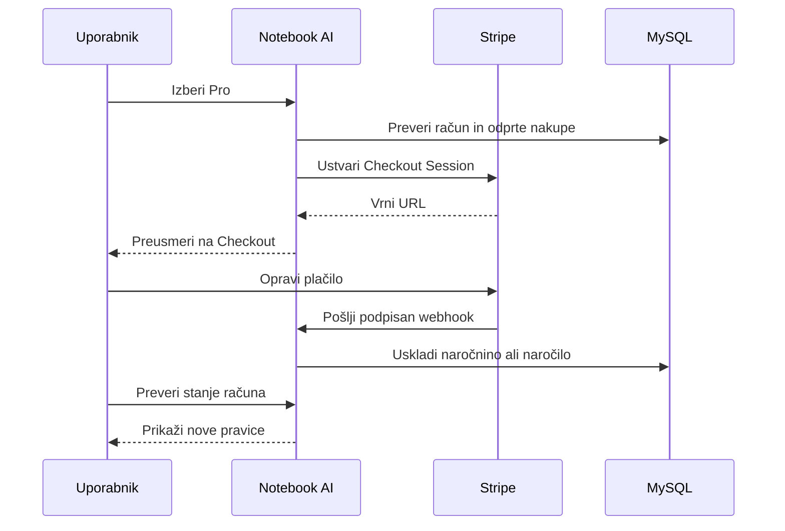

# Notebook AI: načrt integracije Stripe plačil

Tehnični vodič za maturitetni projekt · November 2026  
Obseg: načrt, podatkovni model, delni primeri kode in preizkusni scenariji. Vodič ne spreminja aplikacije ali baze in ne vklaplja pravih plačil.

## 1. Predlog za Notebook AI

Za prvo različico bi uvedel **Free + Pro**, pri čemer ima Pro dve ceni: mesečno in letno. Za plačilo uporabite **Stripe Checkout**, za upravljanje naročnine **Stripe Customer Portal**, za posodabljanje pravic v aplikaciji pa **podpisane webhooke**. To se ujema z obstoječo arhitekturo: HTML/Tailwind in JavaScript v brskalniku, Express in prijavne seje na strežniku ter MySQL/MariaDB za podatke.

Najprej izdelajte plačilni tok v testnem okolju. Prvi uporabni dokaz je: prijavljeni dijak izbere Pro, opravi testno plačilo, webhook posodobi bazo, strežnik odklene več generiranj kvizov, dijak pa lahko naročnino prek portala odpove. Testni scenarij naj zajame še uporabnika, ki po plačilu zapre zavihek in se ne vrne na stran za uspeh.

Glavna ločitev: **Stripe je vir resnice za plačilo in obračun; Notebook AI za uporabniški račun, učne podatke, pravice in porabo.** Plačilo ne spreminja lastništva zapiskov. Uporabnik ob prehodu nazaj na Free še vedno dostopa do svojih zapiskov; spremeni se na primer samo količina novih AI generiranj.

### Ilustrativna ponudba

| Ponudba | Vrsta | Primer cene | Predlagana pravica |
|---|---|---:|---|
| Free | Brez Checkouta | 0 € | Zapiski, predmeti in 5 uspešnih AI generiranj na koledarski mesec |
| Pro Monthly | Ponavljajoča se mesečna cena | 4,99 € / mesec | 100 uspešnih AI generiranj na koledarski mesec |
| Pro Yearly | Ponavljajoča se letna cena | 39,99 € / leto | Iste pravice kot Pro Monthly, drugačen obračun |
| Paket 20 kvizov | Enkratni nakup | 2,99 € | 20 dodatnih generiranj, ob jasnih pravilih porabe in veljavnosti |
| Šolska licenca | Pogodba in račun ali drugačen Stripe tok | Po dogovoru | Sedeži za organizacijo; zahteva ločen organizacijski model |

Cene in kvote so izmišljene za načrtovanje. Pred prodajo preverite strošek modela, Stripe stroške, davke, vračila in podporo. Letni paket lahko pravice obnavlja mesečno, če to jasno opišete; uporabnik letno plača enkrat, kvota pa se lahko vseeno ponastavi vsak mesec. Za prvi MVP izberite en časovni pas (npr. UTC) za kvote in opišite prehod med meseci. Enkratnih kreditov, letne cene in šolske prodaje ni treba izdati hkrati.

## 2. Kateri Stripe izdelek rešuje kateri problem

| Možnost | Primer v Notebook AI | Kaj bi uporabili |
|---|---|---|
| Kartica ali drug podprt način za naročnino | Pro mesečno ali letno | Checkout, `mode: 'subscription'`, recurring Price |
| Enkratno plačilo | Paket kreditov ali časovno omejen maturitetni paket | Checkout, `mode: 'payment'`, one-time Price |
| Samo shranitev plačilne metode | Kasnejše zaračunavanje po posebej dogovorjenih pravilih | Checkout `mode: 'setup'`; sam ne izvede plačila |
| Urejanje obstoječe naročnine | Odpoved, posodobitev kartice, prikaz računov | Customer Portal s konfiguriranimi možnostmi |
| Račun za organizacijo | Šola želi predračun ali plačilo po računu | Stripe Invoicing ali obstoječa računovodska rešitev; ločeno od osebnih računov |
| Plačilo po porabi | Zaračunavanje na podlagi uporabe provizije ali enot | Stripe Billing metered pricing; ni priporočeno za prvi MVP |

Payment Links so uporabni za hiter preizkus ponudbe, vendar strežniško ustvarjanje Checkout Session bolje poveže nakup s prijavljeno sejo, lastnim naročilom in dovoljenim izdelkom. Payment Element bi bil smiseln, če bi kasneje želeli lasten plačilni vmesnik; za prvo verzijo doda delo, ki ga gostovana stran že opravi. Stripe Connect potrebujete šele, če bi posredovali plačila drugim prodajalcem, ne pa samo zato, ker ima aplikacija več avtorjev.

### Plačilne metode

Za MVP testirajte kartice, vključno s potrditvijo 3-D Secure in zavrnjeno kartico. Če uporabljate dinamične plačilne metode v Checkout, prikazane možnosti niso enake za vsakega kupca: odvisne so od konfiguracije, naprave oziroma brskalnika, države, valute in načina Checkouta. Apple Pay in Google Pay preverite na dejansko podprtih napravah; ne obljubljajte, da bosta vedno prikazana. SEPA Direct Debit uvedite šele, ko tok razlikuje plačila v obdelavi od potrjenih in obravnava poznejše neuspehe oziroma spore. Ne sklepajte, da je vsaka metoda za enkratno plačilo podprta tudi za samodejno obnovo naročnine.

## 3. Kako plačilo pride od gumba do nove pravice



Stran `/billing/success` je namenjena sporočilu »Plačilo preverjamo«, ne neposrednemu odklepanju. URL lahko uporabnik odpre sam, preusmeritev lahko prispe pred webhookom, pri nekaterih načinih pa je plačilo še v obdelavi. Ko brskalnik osveži `GET /api/billing/status`, strežnik prebere pravice uporabnika iz prijavne seje in lokalne projekcije. Če želite prikaz podrobnosti Checkout Session, ga poiščite na strežniku in preverite lastništvo; sam `session_id` ni dokaz lastništva.

## 4. Stripe Dashboard in konfiguracija

1. Določite, kdo je dejanski ponudnik in kdo sme upravljati Stripe račun. Za šolski demo ostanite v testnem načinu. Slovenija je na Stripe seznamu podprtih držav, vendar to ne pomeni, da je račun samodejno odobren ali da lahko pravi promet vodite brez urejenega poslovnega in davčnega statusa.
2. V testnem okolju ustvarite **Product: Notebook AI Pro** in dva ločena **Price** objekta (mesečni in letni). Za kredite ustvarite drug Product z enkratno ceno.
3. Vključite Customer Portal. Za prvi MVP omogočite posodobitev plačilne metode, ogled zgodovine ter odpoved ob koncu obdobja. Preklop paketov omogočite šele, ko testirate obračun in pravice.
4. Uskladite identifikatorje Price s strežniško konfiguracijo. Če se cena spremeni, ustvarite novo Price in ohranite preslikavo za stare cene, dokler obstajajo stare naročnine. Starih naročnikov ne preklopite zgolj z zamenjavo okoljske spremenljivke.
5. Določite različico Stripe API za klice in webhook endpoint ter jo zabeležite v dokumentaciji projekta. Primer spodaj obravnava eno postavko naročnine; preverite dejanski JSON na izbrani različici.

```dotenv
# .env.example — samo prazna polja, brez skrivnosti
APP_BASE_URL=http://localhost:3200
STRIPE_SECRET_KEY=
STRIPE_WEBHOOK_SECRET=
STRIPE_API_VERSION=
STRIPE_EXPECT_LIVE=false
STRIPE_PRICE_PRO_MONTHLY=
STRIPE_PRICE_PRO_YEARLY=
STRIPE_PRICE_CREDITS_20=
```

`npm install stripe` namesti strežniški SDK; commitajte tudi lockfile. Za gostovani Checkout, ki ga odprete z vrnjenim URL-jem, na frontendu ni treba inicializirati Stripe.js. Skrivni ključ in webhook podpisna skrivnost sta različni vrednosti. CLI in Dashboard endpoint imata lahko različni podpisni skrivnosti; live in test ključi, cene, Customerji, portali in webhooki naj bodo ločeni. Pred zagonom zahtevajte potrebne nastavitve in zavrnite nepopolno konfiguracijo. Produkcijski `APP_BASE_URL` naj bo vnaprej nastavljen HTTPS naslov, ne vrednost iz zahteve.

## 5. Podatkovni model ob obstoječi bazi studygraph

Obstoječi `users.id` je izhodišče. `notes`, `subjects`, `quizzes` in `exams` ni treba spreminjati zaradi Stripe. Naslednja migracija je predlog za **ločeno testno bazo na okolje**. Pri več Stripe računih ali mešanju okolij uporabite sestavljene ključe z identifikatorjem okolja oziroma računa; enostavna shema spodaj predpostavlja en Stripe račun in en način na bazo.

```sql
CREATE TABLE billing_customers (
    user_id INT UNSIGNED PRIMARY KEY,
    stripe_customer_id VARCHAR(255) CHARACTER SET ascii COLLATE ascii_bin NOT NULL UNIQUE,
    created_at TIMESTAMP NOT NULL DEFAULT CURRENT_TIMESTAMP,
    CONSTRAINT fk_billing_customer_user FOREIGN KEY (user_id)
        REFERENCES users(id) ON DELETE RESTRICT
) ENGINE=InnoDB;

CREATE TABLE billing_subscriptions (
    stripe_subscription_id VARCHAR(255) CHARACTER SET ascii COLLATE ascii_bin PRIMARY KEY,
    user_id INT UNSIGNED NOT NULL,
    stripe_price_id VARCHAR(255) CHARACTER SET ascii COLLATE ascii_bin NOT NULL,
    stripe_status VARCHAR(32) NOT NULL,
    current_period_end DATETIME NULL,
    cancel_at_period_end BOOLEAN NOT NULL DEFAULT FALSE,
    synced_at DATETIME NOT NULL,
    INDEX idx_billing_sub_user (user_id, stripe_status),
    CONSTRAINT fk_billing_sub_customer FOREIGN KEY (user_id)
        REFERENCES billing_customers(user_id) ON DELETE RESTRICT
) ENGINE=InnoDB;

CREATE TABLE billing_orders (
    id CHAR(36) CHARACTER SET ascii COLLATE ascii_bin PRIMARY KEY,
    user_id INT UNSIGNED NOT NULL,
    offer_code VARCHAR(40) NOT NULL,
    checkout_mode ENUM('subscription', 'payment') NOT NULL,
    stripe_price_id VARCHAR(255) CHARACTER SET ascii COLLATE ascii_bin NOT NULL,
    stripe_session_id VARCHAR(255) CHARACTER SET ascii COLLATE ascii_bin NULL UNIQUE,
    stripe_payment_intent_id VARCHAR(255) CHARACTER SET ascii COLLATE ascii_bin NULL UNIQUE,
    state ENUM('created','open','pending','fulfilled','expired','failed') NOT NULL,
    granted_credits INT UNSIGNED NOT NULL DEFAULT 0,
    amount_total_minor BIGINT UNSIGNED NULL,
    currency CHAR(3) NULL,
    created_at TIMESTAMP NOT NULL DEFAULT CURRENT_TIMESTAMP,
    INDEX idx_billing_orders_user (user_id, state),
    CONSTRAINT fk_billing_orders_customer FOREIGN KEY (user_id)
        REFERENCES billing_customers(user_id) ON DELETE RESTRICT
) ENGINE=InnoDB;

CREATE TABLE stripe_webhook_events (
    stripe_event_id VARCHAR(255) CHARACTER SET ascii COLLATE ascii_bin PRIMARY KEY,
    event_type VARCHAR(100) NOT NULL,
    processed_at DATETIME NOT NULL
) ENGINE=InnoDB;

CREATE TABLE ai_usage_monthly (
    user_id INT UNSIGNED NOT NULL,
    bucket_start DATE NOT NULL,
    successful_count INT UNSIGNED NOT NULL DEFAULT 0,
    reserved_count INT UNSIGNED NOT NULL DEFAULT 0,
    PRIMARY KEY (user_id, bucket_start),
    CONSTRAINT fk_ai_usage_user FOREIGN KEY (user_id)
        REFERENCES users(id) ON DELETE CASCADE
) ENGINE=InnoDB;
```

Denar shranjujte v najmanjši enoti valute (npr. 499 za 4,99 EUR), ne kot JavaScript decimalni znesek ali SQL `FLOAT`. Ne predpostavljajte, da ima vsaka valuta dve decimalki. Znesek za prikaz in finančno evidenco vzemite iz potrjenih Stripe objektov, saj končni znesek lahko vključuje popust ali davek. Nastavite UTC za časovne oznake v aplikaciji in bazi.

`RESTRICT` je nameren: izbris aplikacijskega uporabnika ne sme tiho pustiti žive naročnine zunaj baze. To ni dovoljenje za neomejeno hrambo. Pred produkcijo načrtujte odpoved, poravnavo odprtih operacij, ločeno minimalno računovodsko evidenco in odstranitev ali ustrezno ločitev povezav, ki jih ni več treba hraniti. Za kredite dodajte denarnico in knjigo premikov; `granted_credits` na naročilu je dokaz dodelitve, ne trenutno stanje.

## 6. Poti Express in ločitev odgovornosti

| Pot | Kdo jo kliče | Naloga |
|---|---|---|
| `GET /api/billing/status` | Prijavljeni uporabnik | Prikaže paket, stanje odpovedi, kvoto in opcijsko razpoložljive kredite |
| `POST /api/billing/checkout` | Prijavljeni uporabnik | Iz interne kode izdela ali vrne obstoječi Checkout |
| `POST /api/billing/portal` | Prijavljeni uporabnik | Ustvari kratkoživo povezavo za njegov Stripe Customer |
| `POST /api/stripe/webhook` | Stripe | Preveri podpis in uskladi lokalno stanje |
| `POST /api/quiz` | Prijavljeni uporabnik | Pred klicem OpenRouter preveri pravico in rezervira kvoto |

Predlagana razdelitev: `billing/stripeClient.js`, `billing/offers.js`, `billing/reconcile.js`, `routes/billing.js`, `routes/stripeWebhook.js`, `model/dbBilling.js` in `migrations/...`. Koda v vodiču je referenca, ne komplet za kopiranje: pomožne funkcije, CSRF, spremembe baze, logging, transakcije in testi morajo biti pred vklopom implementirani. Uporabite obstoječi `requireAuth` in `req.session.userId`; ne sprejemajte uporabniškega ID-ja od brskalnika.

### 6.1 Strežniški katalog in Checkout

Brskalnik pošlje samo `offer: 'pro_monthly'` ipd. Strežnik sam določi `price_...`, količino, način Checkouta in Customer.

```js
const offers = new Map([
  ['pro_monthly', { mode: 'subscription', price: process.env.STRIPE_PRICE_PRO_MONTHLY }],
  ['pro_yearly', { mode: 'subscription', price: process.env.STRIPE_PRICE_PRO_YEARLY }],
  ['credits_20', { mode: 'payment', price: process.env.STRIPE_PRICE_CREDITS_20 }],
]);

router.post('/checkout', requireAuth, requireCsrf, async (req, res, next) => {
  try {
    const userId = req.session.userId;
    const code = req.body?.offer;
    const offer = offers.get(code);
    if (!offer?.price) {
      return res.status(400).json({ error: 'Ponudba ni na voljo.' });
    }

    // Pomožna funkcija: trajno zveže lokalni račun s Stripe Customerjem.
    const customer = await getOrCreateBillingCustomer(userId);
    // Pomožna funkcija: preveri aktivno naročnino in rezervira ali ponovno uporabi nakup.
    const order = await reserveOrReuseCheckout(userId, code, offer);
    if (order.reusableUrl) return res.json({ url: order.reusableUrl });

    const metadata = { order_id: order.id };
    const session = await stripe.checkout.sessions.create({
      customer: customer.stripe_customer_id,
      mode: offer.mode,
      line_items: [{ price: order.stripe_price_id, quantity: 1 }],
      client_reference_id: order.id,
      metadata,
      ...(offer.mode === 'subscription' ? { subscription_data: { metadata } } : {}),
      success_url: appBase + '/billing/success?session_id={CHECKOUT_SESSION_ID}',
      cancel_url: appBase + '/billing',
    }, { idempotencyKey: 'notebook-checkout:' + order.id });

    await attachCheckoutSession(order.id, session.id);
    return res.json({ url: session.url });
  } catch (error) {
    next(error);
  }
});
```

Pomožne funkcije morajo imeti naslednje lastnosti:

- **Customer**: preslikava po internem `user_id`, ne po e-pošti. Ustvarjanje sprožite šele, ko je potrebno. Za vzporedna zahtevka uporabite trajno rezervacijo operacije, lokalno unikatnost in isti Stripe idempotency key pri ponovitvi istih parametrov. E-pošto posredujte samo, če je potrebna in opisana v politiki zasebnosti.
- **Odprti Checkout**: rezervacijo ustvarite pod kratko lokalno ključavnico za uporabnika, nato Stripe klic izvedite brez odprte SQL transakcije. Drugi klik naj dobi isto še veljavno sejo ali odgovor »nakup se pripravlja«. Za Pro blokirajte vzporedni mesečni in letni nakup. Uporabnika z obstoječo naročnino usmerite v Portal; upoštevajte tudi neporavnane in začasno čakajoče naročnine.
- **Ponovitev po timeoutu**: isti poskus pomeni isti lokalni UUID in isti idempotency key s povsem istimi parametri. Po izteku veljavnosti Stripe idempotency zapisa ne predpostavite, da je staro zahtevo varno ponoviti: najprej uskladite obstoječo sejo oziroma Stripe stanje. Nov namerni nakup po poteku ima nov UUID.
- **Vrstni red**: lokalno naročilo obstaja pred Stripe klicem. Webhook lahko nastopi pred zapisom `stripe_session_id`; obdelovalec naj pod transakcijo pogleda `order_id`, preveri Customer, način, postavko in količino ter sejo poveže le, če še ni nastavljena ali se že ujema. Funkcija `attachCheckoutSession` ne sme spremeniti že izpolnjene transakcije nazaj v odprto.
- **Zaprtje Checkouta**: obisk `cancel_url` ne pomeni nujno, da je seja neveljavna. Sejo obravnavajte kot odprto, dokler je veljavna, ali jo izrecno končajte po pravilih ponudbe in Stripe API.

### 6.2 Customer Portal

```js
router.post('/portal', requireAuth, requireCsrf, async (req, res, next) => {
  try {
    const customer = await getBillingCustomer(req.session.userId);
    if (!customer) return res.status(404).json({ error: 'Plačilni račun še ne obstaja.' });

    const portal = await stripe.billingPortal.sessions.create({
      customer: customer.stripe_customer_id,
      return_url: appBase + '/billing',
    });
    return res.json({ url: portal.url });
  } catch (error) {
    next(error);
  }
});
```

Povezave generirajte ob kliku in jih ne shranjujte kot stalne povezave. Portalove spremembe odražajte iz podpisanih dogodkov, ne iz obiska povratne strani. Pred omogočanjem nadgradenj določite, ali je prehod takojšen ali ob obnovi in ali se obračuna sorazmerni znesek (*proration*). Primer: prehod z mesečnega na letni paket po 12 dneh ne sme uporabnika presenetiti z zneskom ali dvojnim obračunom.

## 7. Webhook: podpis, vrstni red in ponovitve

V `app.js` naj bo Stripe webhook registriran **pred** globalnim `express.json()`. Stripe preverja originalne bajte telesa; rekonstruirani JSON ni enakovreden. Na tej eni poti uporabite podpis, ne prijavne seje ali CSRF žetona. Ostale POST poti obdržijo običajne zaščite.

```js
app.post('/api/stripe/webhook',
  express.raw({ type: 'application/json' }),
  async (req, res) => {
    let event;
    try {
      event = stripe.webhooks.constructEvent(
        req.body,
        req.get('stripe-signature'),
        process.env.STRIPE_WEBHOOK_SECRET
      );
    } catch {
      return res.sendStatus(400);
    }

    if (event.livemode !== (process.env.STRIPE_EXPECT_LIVE === 'true')) {
      return res.sendStatus(400);
    }

    try {
      await processStripeEvent(event);
      return res.sendStatus(200);
    } catch (error) {
      logBillingFailure({ eventId: event.id, type: event.type });
      return res.sendStatus(500);
    }
  }
);
app.use(express.json());
// Preostali session middleware in poti naj imajo pravilni vrstni red.
```

### 7.1 Dogodki za prvo izdajo

| Dogodek | Priporočen odziv |
|---|---|
| `checkout.session.completed` | Pri naročnini poveži nakup in sinhroniziraj Stripe Subscription. Pri enkratnem paketu dodeli kredit le ob potrjenem plačilu, sicer označi pending. |
| `checkout.session.async_payment_succeeded` | Potrdi zakasnjeno enkratno plačilo in uporabi isto idempotentno dodelitev. |
| `checkout.session.async_payment_failed` | Označi še neizpolnjen nakup kot neuspešen; ne odvzemaj kreditov na podlagi starega dogodka. |
| `checkout.session.expired` | Zapri odprti nakup, če še ni izpolnjen. |
| `customer.subscription.created`, `.updated`, `.deleted` | Preračunaj pravice iz aktualne naročnine; zabeleži načrtovano odpoved. |
| `invoice.paid` | Uskladi naročnino po potrjenem računu, vključno z obnovami. Ne kreiraj nove naročnine ali dodeli enkratnih kreditov iz računa. |
| `invoice.payment_failed` | Osveži status, prikaži opozorilo in povezavo do Portala. Dostop določa vaša politika. |
| `invoice.payment_action_required` | Po potrebi pokaži, da mora uporabnik potrditi plačilo. |
| Vračilo ali spor | Za produkcijske enkratne nakupe načrtuj sinhronizacijo vračil in sporov, npr. z `refund.updated` in `charge.dispute.created`; podprt nabor preveri na izbrani API verziji. |

### 7.2 Obdelava, ki ne podvoji pravic

1. Dogodek po uspešnem preverjanju podpisa povežite s Checkout Session, Customerjem ali Subscription. Pri računu preverite, ali sploh pripada naročnini, in uporabite polja iz dejanske API različice. Neznan dogodek lahko prezrete; pričakovan dogodek z manjkajočim lokalnim naročilom naj gre v nadzorovano ponovno obdelavo ali preiskavo.
2. Stripe ne zagotavlja vrstnega reda dostave. Kjer je mogoče, za spremembe naročnine pridobite aktualen objekt prek Stripe API; ne zaključite »zadnji prispeli webhook zmaga«. Za vzporedne dogodke serializirajte usklajevanje po naročnini **pred** branjem Stripe stanja, na primer z enim delavcem na ključ naročnine, ali uporabite drug mehanizem, ki prepreči, da počasnejša stara uskladitev prepiše novejšo. Dodajte periodično usklajevanje za primere izpada.
3. V isti MySQL transakciji zabeležite ID dogodka in izvedite njegovo lokalno posledico, vključno s spremem­bo naročila, naročnine ali denarnice. Če sprememba odpove, rollback ohrani možnost ponovitve. Dvojnik ID-ja obravnavajte posebej na ključu za dogodke; druge SQL napake niso dvojniki.
4. Poleg ID-ja dogodka preverite poslovni ključ. Dva različna dogodka lahko opisujeta isto plačilo. Pri kreditih zaklenite zapis naročila in dovolite samo en knjižen premik s ključem `purchase:<order_id>`. `fulfilled` je končno stanje dodelitve, vračilo naj bo nov premik, ne brisanje zgodovine.
5. Pri majhnem demu lahko pot odgovori po kratki transakciji. V produkciji uporabite trajni inbox ali vrsto: odgovorite `2xx` šele, ko je dogodek res zapisan, delavec pa mora imeti lastne ponovitve, zaklepe, alarm in obravnavo nedostavljivih dogodkov. In-memory queue brez trajnega zapisa ni primerna. Za inbox potrebujete dodatno shemo in omejeno hrambo vsebine.

Pri novejših API različicah so podatki o tekočem obračunskem obdobju lahko na Subscription Item, ne več na vrhnjem Subscription objektu. Za model z eno postavko jo pridobite po pričakovanem Price in preverite njeno obdobje. `invoice.paid` je signal za sinhronizacijo, ne samostojen dokaz, da je vsaka naročnina trenutno aktivna. Enako Checkout metadata sama ni dokaz plačila: preverite podpisan ali prek Stripe API pridobljen objekt, status, Customer, vezavo na naročilo, valuto in dogovorjene postavke; popuste in davke obravnavajte skladno s konfiguracijo.

### 7.3 Primer ponovitev z resničnim učinkom v bazi

Predstavljajte si nakup kreditov, ki ga Stripe najprej označi kot še neplačanega:

1. Ob 14:02 prispe `checkout.session.completed` za naročilo X. Plačilo je še v obdelavi. Naročilo X dobi stanje `pending`; uporabnik dobi 0 kreditov.
2. Ob 14:06 prispe `checkout.session.async_payment_succeeded`. Delavec znova pridobi sejo in postavke ter preveri `payment_status: 'paid'`. V eni transakciji zabeleži Dogodek B, zaklene naročilo X, doda premik `purchase:X` z +20 in naročilo označi kot `fulfilled`.
3. Omrežje izgubi HTTP odgovor. Stripe ponovi Dogodek B. Ker je njegova transakcija že potrjena, ponovitev konča brez novega premika in vrne uspešno potrditev.
4. Pozneje prispe še starejši dogodek o čakajočem plačilu. Naročilo ostane `fulfilled`. Stanja se ne vračajo nazaj samo zato, ker dogodek prispe pozneje.

Za pozitivno plačljiv paket zahtevajte `paid`. Če pozneje uvedete 100-odstotne popuste ali brezplačno ponudbo prek Checkouta, zanjo izrecno določite, ali je `no_payment_required` sprejemljiv in pod katerimi pogoji; trenutni plačljivi paket naj tega stanja ne obravnava kot prejeto plačilo.

## 8. Pravice, AI kvote in poslovna pravila

| Stripe stanje | Predlog za Notebook AI |
|---|---|
| `active` | Pro, če je dovoljen Price in se stanje ujema s politiko obračuna. |
| `trialing` | Pro le, če trial namenoma omogočite; za MVP ga izpustite. |
| `active` + načrtovana odpoved | Pro do dejanskega prenehanja; prikaži datum in počakaj na sinhronizacijo. |
| `past_due` | Za demo vrni Free in pokaži opozorilo; alternativa je jasno določeno prehodno obdobje, npr. 3 dni, z enim trajno zabeleženim začetkom. |
| `incomplete`, `incomplete_expired`, `unpaid`, `canceled`, `paused` | Free; ne izbriši zapiskov in ne prekliči ločeno kupljenih kreditov samo zaradi stanja Pro. |
| Neznano stanje ali neznan Price | Ne odklepaj; opozori ekipo in uskladi stanje. |

Politika je predlog za vaš produkt, ne pravilo Stripe. `pause_collection` in status `paused` nista isto; če omogočite premore pobiranja plačil, določite lasten učinek na pravice. Za dinamično UI ne dodajajte zgolj stolpca `users.is_pro`: tak podatek sam ne pove, iz katere naročnine izhaja pravica in kdaj jo je treba odstraniti. Če ima uporabnik zaradi incidenta dve naročnini, izračunajte rezultat iz dovoljenih veljavnih zapisov, primer pa obvezno izpostavite podpori; ne odpovedujte ali vračajte nakupov samodejno brez pravil.

### 8.1 Uveljavitev v obstoječi poti za kviz

1. V `POST /api/quiz` preverite prijavo ter lastništvo zapiska in predmeta. Pro ne omogoča uporabe zapiskov drugih uporabnikov.
2. Iz baze izračunajte trenutno kvoto in v kratki transakciji rezervirajte eno enoto, če velja `successful_count + reserved_count < limit`. Pri kreditih podobno zaklenite denarnico in rezervirajte največ eno enoto.
3. Kličite OpenRouter zunaj transakcije. Omejite dolžino vira, `number_of_questions`, čas čakanja in pogostost zahtevkov. Dolga besedila in dragi ponovni poskusi lahko povzročijo strošek, četudi rezultat ni shranjen.
4. Po uspešnem validiranju odgovora in shranjevanju kviza v isti transakciji dokončajte rezervacijo. Na napaki jo sprostite. Za resnično robustnost dodajte tabelo rezervacij s ključem generiranja, stanjem in časom poteka; zgolj števec se po padcu procesa sam ne popravi. Pozna dokončanja že sproščenih rezervacij naj imajo izrecno pravilo.
5. Preprečite dvojni klic in dvojno porabo pri ponovnem pošiljanju istega obrazca. Uporabite interni ID zahteve, vezan na uporabnika in parametre, ter isti rezultat za ponovitev že končane zahteve. Nastavite globalni proračun in alarme, ne samo kvote na uporabnika.

Sprememba iz Free v Pro naj zviša mejo v istem mesecu, ne ponastavi že porabljenih enot. Pri vračilu na Free po 30 ustvarjenih kvizih naj uporabnik vidi, da za ta mesec nima več brezplačne kvote; že obstoječi kvizi ostanejo dostopni. Vmesnik naj pokaže kot razlago, ali je zahteva zavrnjena zaradi kvote, začasne nedosegljivosti ali pomanjkanja pravic.

### 8.2 Življenjski cikel naročnine na konkretnem primeru

Ana kupi mesečni Pro. Checkout se zaključi, lokalno naročilo pa do uskladitve kaže »preverjamo plačilo«. Ko strežnik potrdi njeno naročnino in dovoljeni Price, račun preide na Pro. Ana ima v tekočem mesecu že tri generiranja, zato ima pri kvoti 100 še 97 enot.

Ob naslednjem obračunu je kartica zavrnjena. Aplikacija osveži status in pokaže »Posodobi način plačila«. Če ste izbrali strogo pravilo, se Ana začasno vrne na Free; če ste izbrali prehodno obdobje, ga ponovljeni webhooki ne smejo podaljševati. Ko Stripe uspešno pobere plačilo, naslednja uskladitev ponovno oceni njene pravice. Ne enačite obvestila o neuspelem plačilu z dejansko odpovedjo naročnine.

Ana nato prek Portala naročnino odpove **ob koncu obdobja**. Na Billing se takoj prikaže datum, vendar pravice ostanejo do prenehanja. Če si premisli in načrtovano odpoved prekliče, naj nov Stripe status odstrani stari napis. Ko naročnina dejansko preneha, se njeni zapiski ne premaknejo, izbrišejo ali skrijejo. To je treba preizkusiti tudi ob kratkem izpadu webhook endpointa.

## 9. Enkratni paketi, vračila in spori

Za paket 20 kreditov Checkout obdelava preveri lokalno naročilo in pripadajočo postavko, nato pod transakcijo doda 20 enot. Enota pomeni npr. en uspešno ustvarjen kviz znotraj objavljenih omejitev. Pravila veljavnosti, prenosljivosti, porabe in vrstnega reda morajo biti vidna pred nakupom. Primer politike: najprej uporabite vključeno mesečno kvoto, nato plačane kredite. Ne začnite z zapadanjem kreditov, če še ne morete jasno prikazati stanja, datuma in posledic.

V produkciji zabeležite vsaj premike `purchase +20`, `quiz_use -1`, `refund_adjustment` in `manual_adjustment` z enoličnimi poslovnimi ključi ter razlogom. Uporabniku prikažite stanja in osnovno zgodovino. Nikoli ne brišite zgodovine samo zato, da bi zneski ponovno izgledali pravilni.

Vračilo in odpoved sta ločeni operaciji. Odpoved zaključuje prihodnje obračune glede na nastavitve; vračilo se nanaša na preteklo transakcijo. Model mora ločiti polno in delno vračilo, porabljene kredite, neuspešno oziroma čakajoče vračilo in spor. Ne uvedite avtomatike, ki za vsako delno vračilo odvzame cel paket; za prvi manjši obseg je bolj obvladljiva ročna obravnava s pregledno evidenco. Administrativni koraki zahtevajo ločeno dovoljenje in revizijski zapis, pri ponovljivih klicih pa poslovni idempotency key.

## 10. Uporabniški vmesnik

V obstoječem stranskem meniju dodajte `Billing` ali `Naročnina`. Stran naj prikaže trenutni paket, mesečno porabo, možnosti menjave, upravljanje plačil in kontakt. Pri letni ceni naj bo celotni letni znesek jasno naveden; mesečni preračun je samo dopolnilna informacija.

Ko uporabnik klikne gumb, ga začasno onemogočite in pošljite JSON na lastno Express pot. Pri uspehu ga preusmerite na URL, ki ga je Express pravkar prejel od Stripe. Pri napaki gumb spet omogočite in prikažite kratko sporočilo. Ponovni klik v brskalniku sam po sebi ni mehanizem proti dvojnemu nakupu.

Stran po vrnitvi naj nekajkrat z zamikom preveri `/api/billing/status`, nato prikaže trajno razumljivo stanje: »Pro je aktiven«, »Plačilo še preverjamo«, ali »Če se stanje ne spremeni, preveri Billing ali kontaktiraj podporo«. Če je plačilo zakasnjeno, se mora stanje pravilno spremeniti tudi brez odprtega zavihka. Vmesnik ne sme ročno zapisati paketa v `localStorage` in ga obravnavati kot dovoljenje.

## 11. Varnost, zasebnost in priprava na pravi promet

- Kartic, CVC, bančnih poverilnic in webhook skrivnosti ne vnašajte v MySQL ali frontend. Gostovani Checkout zmanjša neposredno obdelavo kartic, ne odpravi pa potrebe po preverjanju obveznosti glede plačilne varnosti.
- Pri poteh, ki uporabljajo prijavne piškotke, uvedite CSRF zaščito in ustrezne nastavitve sej ter HTTPS. Omejite pogostost Checkout/Portal zahtev. SQL parametre vezite s placeholderji, ne z lepljenjem nizov. Webhook podpis preverjajte z uradnim SDK in pravilno uro strežnika.
- V Stripe metadata dodajte največ interne tehnične identifikatorje. Ne pošiljajte zapiskov, OpenRouter promptov, šolskih ocen ali gesel. V loge zapisujte ID dogodka, okolje, kodo napake in interni ID nakupa; ne celotnega telesa webhooka, Checkout URL-ja ali skrivnosti.
- Nadzirajte dvojne naročnine, stare `pending` nakupe, neskladje med Stripe in bazo ter neobdelane dogodke. Zapišite postopek za rotacijo ključev, izpad webhooka in ponovno uskladitev po obnovi baze.
- Posodobite politiko zasebnosti in pogoje pred objavo: opišite plačilne kategorije podatkov, vlogo Stripe glede na uporabljene storitve in pogoje, prejemnike, hrambo, podporo, obračun, samodejno obnovo, odpovedi in vračila. Ločite šolski demo od dejanske prodaje, zlasti če ciljate na mladoletne.
- Stripe Checkout, izdaja Stripe računa in Stripe Tax niso sami po sebi dokaz, da so izpolnjene slovenske obveznosti glede računov, davčnega potrjevanja, DDV oziroma čezmejne prodaje. Pred live zagonom se s šolo, odgovornim ponudnikom in računovodstvom posvetujte o prodajalcu, računih, cenah z davkom, morebitnem OSS, pravilih za potrošnike in hrambi. Ne dodajajte `automatic_tax` kot nadomestilo za te odločitve.
- Ob izbrisu računa si določite postopek: overite zahtevo, preglejte aktivne naročnine in odprta plačila, izvedite dogovorjeno odpoved in nato uredite lokalne in zunanje podatke skladno z veljavnimi obveznostmi. Izbris MySQL vrstice sam ne ustavi Stripe obračuna.

## 12. Lokalni test z XAMPP, Express in Stripe CLI

MySQL/MariaDB lahko še naprej poganjate prek XAMPP. Stripe endpoint ni v Apache oziroma phpMyAdmin: obravnava ga Node/Express na vaših vratih (v primeru 3200). Po namestitvi uradnega Stripe CLI:

```bash
stripe login
stripe listen --forward-to localhost:3200/api/stripe/webhook
```

Podpisno skrivnost, ki jo CLI izpiše za poslušanje, vstavite v lokalno `.env` in ponovno zaženite Node. S testnim Checkoutom izvedite celoten nakup z uradnimi [testnimi karticami](https://docs.stripe.com/testing) in testnim Stripe računom. Sintetični `stripe trigger` je uporaben za preizkus dostave, toda generirani objekti praviloma niso povezani z vašim lokalnim naročilom; ne dokazujejo uspešnega zaključka celotne integracije.

Za obnove uporabite Stripe Billing simulacije oziroma Test Clocks s podprto testno nastavitvijo Customerja in naročnine. Ustrezno nastavitev preverite za vaš Checkout tok; ne predpostavite, da lahko uro naknadno priključite poljubnemu že obstoječemu Customerju. Po premiku ure počakajte na dokončanje simulacije in preverite račun, status in lokalno projekcijo.

### Minimalna testna matrika

| Preizkus | Pričakovanje |
|---|---|
| Mesečni nakup uspe | Ena Stripe naročnina, Pro po uskladitvi in višja kvota. |
| Letni nakup uspe | Ista pravica Pro, drugačen obračun in pravilen prikaz cene. |
| Uporabnik zapre zavihek po potrditvi | Webhook vseeno posodobi račun. |
| Odprta je samo success stran | Brez nove pravice brez potrjenega strežniškega stanja. |
| Kartica zavrnjena ali potreben 3-D Secure | Jasno stanje, brez prezgodnjega odklepa. |
| Dvojni klik ali izgubljen odgovor Stripe API | Ponovna uporaba rezervacije, brez druge odprte naročnine. |
| Dvojni webhook in dva različna dogodka za isto plačilo | Natanko ena dodelitev kreditov. |
| Webhooki v obratnem vrstnem redu | Staro stanje ne prepiše novega. |
| Napačen podpis ali napačno okolje | Zavrnitev brez spremembe v bazi. |
| MySQL odpove po prejemu | Dogodek ni lažno potrjen; ob ponovitvi se pravilno obdela. |
| Obnova uspe oziroma ne uspe | Ustrezno podaljšanje ali prehod po politiki `past_due`. |
| Odpoved ob koncu obdobja | Pro ostane do konca, nato Free brez izgube zapiskov. |
| Poskus dostopa do tujega Portala | Poti ne zaupajo poslanemu Customer ID-ju. |
| Dve vzporedni generiranji ob zadnji enoti | Samo ena zahteva uspešno rezervira enoto. |
| Enkratno plačilo ostane v obdelavi | Brez kreditov do pozitivne potrditve. |
| Delno vračilo po porabi kreditov | Jasna ročna ali dokumentirana avtomatska obravnava. |

## 13. Predlagan vrstni red izvedbe

1. **Testni MVP:** en Pro Price, ena valuta, kartica, SQL migracija, Checkout, Portal, podpisani webhook in `GET /api/billing/status`. Demo brez pravih kartic.
2. **Pravila aplikacije:** kvota Free/Pro na strežniku, zaklep vzporednih nakupov, zaključek in ponovitev webhooka, beleženje neskladij.
3. **Življenjski cikel:** mesečna obnova, letni paket, odpoved, neuspelo plačilo, sprememba kartice in prikaz statusa v Billing.
4. **Enkratna plačila:** ločen katalog, denarnica kreditov, knjiženje, asinhrona plačila, vračila ter podpora.
5. **Odločitev o live zagonu:** potrjen ponudnik, računovodski in pravni pregled, objavljeni pogoji, HTTPS, ločena produkcijska baza in ključi, alarmi ter odgovorna oseba za podporo. Če projekt ostane maturitetni prototip, je dobro stestirana demonstracija v sandboxu že smiseln cilj.

Za dokumentacijo maturitetne naloge zajemite anonimizirane slike izbire paketa, testnega Checkouta, potrjenega statusa, prehoda nazaj na Free in enega neuspešnega scenarija. Pokažite, zakaj razlika med »plačilo končano v brskalniku« in »plačilo potrjeno na strežniku« vpliva na tehnično zasnovo.

## 14. Odpravljanje težav in redno usklajevanje

| Simptom | Kaj preveriti najprej |
|---|---|
| Checkout sporoči, da Price ne obstaja | Ali je cena ustvarjena na istem Stripe računu in v istem načinu kot strežniški ključ; ali je bila skopirana prava vrednost `price_...`. |
| Checkout je uspešen, aplikacija ostane Free | Preverite dostavo webhooka, podpis, uspešnost uskladitve Customerja, kdo je lastnik lokalnega naročila in ali je Price na seznamu upravičenih cen. |
| Webhook vrne 400 | Preverite podpisno skrivnost, pravilni endpoint in vrstni red middleware; skladnost test/live; strežniško uro. |
| Webhook vrne 500 | Preglejte korelacijski ID in rezultat transakcije; ne označite dogodka za obdelanega na roko samo zato, da izgine opozorilo. |
| Customer Portal se ne odpre | Preverite konfiguracijo Portala, obstoj lokalnega Customerja in istovetnost Stripe okolja. Ne rešujte z uporabo Customer ID-ja, ki ga pošlje brskalnik. |
| Stripe kaže dve naročnini | Preverite vzporedne rezervacije, nedokončane seje in časovne omejitve. Prizadeti osebi pojasnite stanje in presodite, katero naročnino popraviti; podatkov v Stripe ne spreminjajte na slepo. |
| Stripe kaže plačilo, v bazi ni lokalnega nakupa | Ne pripišite ga računu po podobni e-pošti. Izsledite povezavo po preverjenem Customerju in internem ID-ju, primer pa vodite kot neskladje za pregled. |

Webhook naj ne bo edini način obnove stanja. Periodično opravilo naj v omejenih paketih ponovno pregleda odprte ali stare nakupe, pretečena obdobja in naročnine, ki se dalj časa niso uskladile. Za vsako uporabi isto poslovno logiko in enake ključe dodelitve kot webhook; sicer bi lahko nočni pregled drugič dodal kredite. Uporabite strani rezultatov, omejene ponovitve in meritev, koliko zapisov še čaka. Pri načrtovanem vzdrževanju je bolje začasno skriti nove Checkout gumbe, kot sprejemati plačila brez zanesljivega načina naknadne uskladitve.

Ločite odpravo napake od vračila denarja. Če lokalno odklepanje ni uspelo, je prvi korak ugotoviti, ali je bilo plačilo res prejeto in ali lahko varno obnovite pravico; ponoven nakup pogosto povzroči drugo naročnino. Ob ročnem posegu zapišite razlog, izvajalca, čas in uporabljen poslovni ključ. V podporni komunikaciji ne zahtevajte celotne številke kartice, gesla ali zaslonske slike z občutljivimi podatki.

## 15. Uradni viri in nadaljnje branje

- Stripe: [dostopnost po državah](https://stripe.com/global), [Checkout](https://docs.stripe.com/payments/checkout), [potrditev in izpolnitev naročila](https://docs.stripe.com/checkout/fulfillment).
- Stripe: [webhooki za naročnine](https://docs.stripe.com/billing/subscriptions/webhooks), [webhook podpisi in dostava](https://docs.stripe.com/webhooks), [idempotentne zahteve](https://docs.stripe.com/api/idempotent_requests).
- Stripe: [Customer Portal](https://docs.stripe.com/customer-management), [združljivost plačilnih metod](https://docs.stripe.com/payments/payment-methods/payment-method-support), [Stripe Tax](https://docs.stripe.com/tax).
- Stripe: [sprememba polj obračunskega obdobja na postavkah naročnine](https://docs.stripe.com/changelog/basil/2025-03-31/deprecate-subscription-current-period-start-and-end), [testiranje](https://docs.stripe.com/testing), [testne ure](https://docs.stripe.com/billing/testing/test-clocks).
- FURS: [uradni portal za preverjanje slovenskih davčnih obveznosti](https://www.fu.gov.si/).

Dokument temelji na znani zasnovi Notebook AI in je načrt za izvedbo, ne trditev, da so plačila že vključena. Pred implementacijo preverite dejanski `app.js`, migracije, gostovanje, izbrane Stripe API različice in poslovna pravila.
